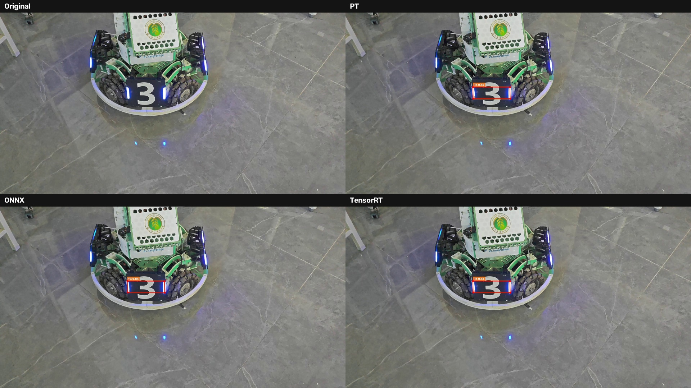
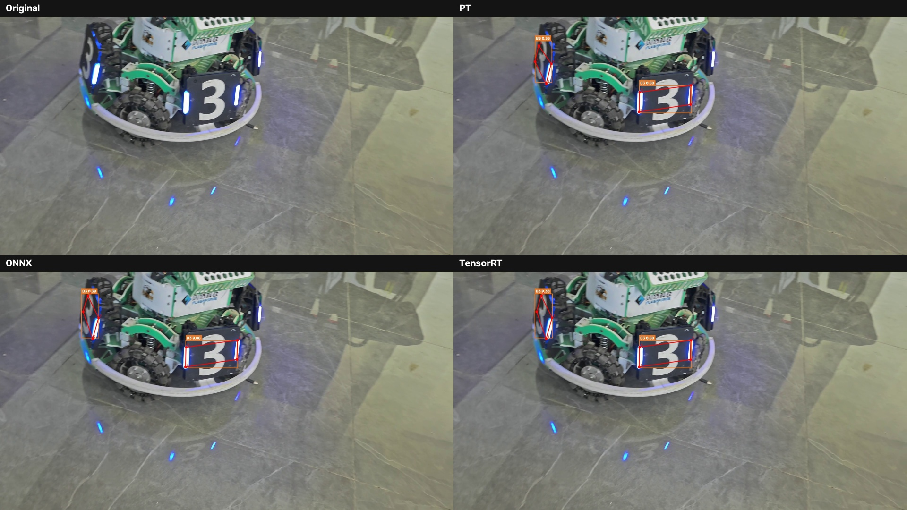

# YOLO26n-pose：.pt / ONNX / TensorRT 推理对比

同一份 YOLO26n-pose 权重在 PyTorch、ONNX Runtime、TensorRT 三种后端下的推理实验，包含模型导出、耗时统计、检测结果和对比截图。

## 1. 模型版本

| 项目 | 值 |
|---|---|
| 模型 | YOLO26n-pose |
| 框架 | Ultralytics 8.4.177 |
| 权重 | `models/best.pt` |
| 输入 | 640 × 640 |
| 类别 | 6 类：B1、B2、B3、R1、R2、R3 |
| 关键点 | 4 个角点，`kpt_shape = [4, 2]` |
| 参数量 | 约 2.45 M |
| 计算量 | 5.6 GFLOPs |
| 文件大小 | 5.62 MB |

## 2. 导出格式与导出方法

### ONNX

| 项目 | 值 |
|---|---|
| 文件 | `models/best.onnx` |
| opset | 18 |
| 精度 | FP16 权重，FP32 输入输出 |
| 输入 | `images [1, 3, 640, 640]` |
| 输出 | `output0 [1, 18, 8400]` |
| 大小 | 4.93 MB |

```powershell
python export-onnx.py
```

关键参数：

```python
format="onnx", imgsz=640, opset=18,
simplify=True, dynamic=False, half=True,
batch=1, device="cpu"
```

### TensorRT

| 项目 | 值 |
|---|---|
| 文件 | `models/best.engine` |
| 版本 | TensorRT 11.4.0.106 |
| 精度 | FP16，SM89 |
| 输入 | `images [1, 3, 640, 640]`，FLOAT |
| 输出 | `output0 [1, 18, 8400]`，FLOAT |
| 大小 | 73.07 MB |

```powershell
trtexec --onnx=models/best.onnx `
        --saveEngine=models/best.engine `
        --memPoolSize=workspace:1G `
        --skipInference
```

TensorRT 11 为 strongly typed，不再支持 `--fp16`；FP16 精度由 ONNX 图决定。

## 3. 运行环境与依赖库

| 组件 | 版本 |
|---|---|
| 操作系统 | Windows |
| Python | 3.11.4 |
| PyTorch | 2.14.1+cu132 |
| torchvision | 0.29.1+cu132 |
| CUDA | 13.2 |
| Ultralytics | 8.4.177 |
| ONNX | 1.23.2 |
| onnxslim | 0.1.98 |
| ONNX Runtime GPU | 1.25.0 |
| TensorRT | 11.4.0.106 |
| OpenCV | 5.0.0.93 |
| NumPy | 2.4.6 |
| GPU | NVIDIA GeForce RTX 4070 Laptop GPU，8 GB |
| 驱动 | 617.42 |

依赖清单见 `requirements.txt`：

```powershell
python -m pip install -r requirements.txt
```

`trtexec` 不是 pip 包，需单独安装 TensorRT 并加入 PATH。

## 4. 推理命令

```powershell
python inference.py
```

默认源视频：

```text
C:\Users\M\Desktop\original_i.mp4
```

默认输出：

```text
C:\Users\M\Desktop\detect\inference
```

`inference.py` 会依次运行 `.pt`、ONNX、TensorRT，输出三个检测视频，正常只打印一行保存结果。

如果源视频在其他位置：

```powershell
$env:SOURCE="C:\path\video.mp4"
python inference.py
```

完整测试：

```powershell
python test.py
```

`test.py` 处理完整视频，输出 `detect/pt.mp4`、`detect/onnx.mp4`、`detect/tensorrt.mp4`，并打印三个模型的帧数、检测框数量、中位数/P95 耗时和平均置信度。源视频路径在脚本中的 `VIDEO` 常量里，原视频不在默认位置时需要修改。

验证 TensorRT engine：

```powershell
trtexec --loadEngine=models/best.engine `
        --iterations=1 --warmUp=0 --duration=1
```

## 5. 原始模型与导出模型的推理结果截图

每张对比图包含四个画面：

- 左上：Original
- 右上：`.pt`
- 左下：ONNX
- 右下：TensorRT





单模型截图：

- [.pt](assets/0000_pt.jpg)
- [ONNX](assets/0000_onnx.jpg)
- [TensorRT](assets/0000_tensorrt.jpg)

## 6. 模型大小、推理耗时及检测效果对比

测试条件：

- 视频：1920 × 1080，60 fps，1277 帧
- 输入：640 × 640，batch=1
- 阈值：conf=0.25，IoU=0.7，max_det=300
- 计时：预处理 + 推理 + 后处理，不含视频读写和画框
- 前 10 帧预热，统计其余 1267 帧

| 对比项目 | 原始 `.pt` 模型 | ONNX | TensorRT |
|---|---:|---:|---:|
| 模型格式 | PyTorch checkpoint | ONNX opset 18，FP16 权重 / FP32 I/O | TensorRT 11.4，FP16，SM89 |
| 模型文件大小 | 5.62 MB | 4.93 MB | 73.07 MB |
| 推理耗时（中位数） | 16.02 ms | 14.32 ms | 14.62 ms |
| 推理耗时（均值 / P95） | 16.66 / 21.43 ms | 14.55 / 17.55 ms | 14.64 / 16.16 ms |
| 等效 FPS | 62.4 | 69.8 | 68.4 |
| 检测目标总数 | 1482 | 1476 | 1477 |
| 平均每帧目标数 | 1.17 | 1.16 | 1.17 |
| 平均置信度 | 0.782 | 0.786 | 0.785 |
| 检测效果 | [0000_pt.jpg](assets/0000_pt.jpg) | [0000_onnx.jpg](assets/0000_onnx.jpg) | [0000_tensorrt.jpg](assets/0000_tensorrt.jpg) |

TensorRT 纯 engine 推理约 3 ms（trtexec 随机输入）。上表为端到端统计，包含 1080p letterbox、Python decode 和 NMS，因此 TensorRT 与 ONNX 总耗时接近。

## 7. 实验过程中遇到的问题及解决方法

| 问题 | 原因 | 解决方法 |
|---|---|---|
| `ModuleNotFoundError: No module named 'tensorrt'` | 环境未安装 TensorRT | 安装 `tensorrt-cu13`、bindings、libs，并配置 `trtexec` |
| `trtexec --fp16` 报 `Unknown option: --fp16` | TensorRT 11 改为 strongly typed，移除了 FP16/INT8 构建开关 | 使用 FP16 ONNX，或使用 ModelOpt AutoCast |
| `format="engine", half=True` 触发 `nvidia-modelopt[onnx]` 自动安装和依赖冲突 | Ultralytics 的 TensorRT 11 FP16 路径依赖 ModelOpt | 改为 ONNX → `trtexec` 构建 |
| engine 在 Ultralytics pose 后处理中报 `zeros: Dimension size must be non-negative` | engine 缺少 pose 元数据，Ultralytics 按 detect 处理 | 自定义 decode + NMS，解析 `1×18×8400` |
| 日志过多 | Ultralytics、ONNX Runtime、TensorRT 默认输出加载信息 | 设置 `YOLO_VERBOSE=False`、`LOGGER.ERROR`、ORT 日志级别、`trt.Logger.ERROR` |
| engine 换机器后不可用 | engine 绑定 GPU 架构、TensorRT 版本和构建参数 | 在目标机器上用 ONNX 重新构建 |

## 8. 模型格式理解与实验结论

`.pt` 是训练检查点，适合训练、验证和调试，部署时依赖 PyTorch。ONNX 是框架无关的计算图，体积最小，适合跨平台部署。TensorRT engine 是针对特定 GPU 和 TensorRT 版本编译的执行计划，纯推理最快，但体积最大、可移植性最差。

本次实验中，ONNX 端到端最快（14.32 ms），TensorRT 次之（14.62 ms），`.pt` 最慢（16.02 ms）。三者检测数量分别为 1482、1476、1477，平均置信度 0.782、0.786、0.785，差异主要来自少量低置信度框和 FP16 量化。

如果部署在固定 NVIDIA GPU 上，且能使用 C++/CUDA 完成前处理和后处理，TensorRT 的优势会更明显；如果需要跨平台或快速集成，ONNX 更合适。
